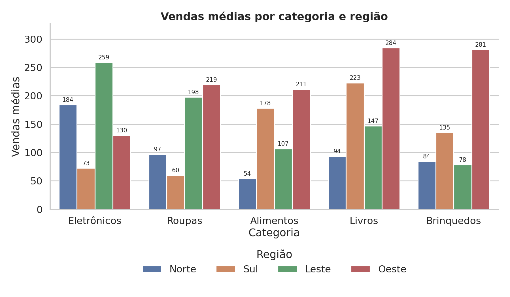
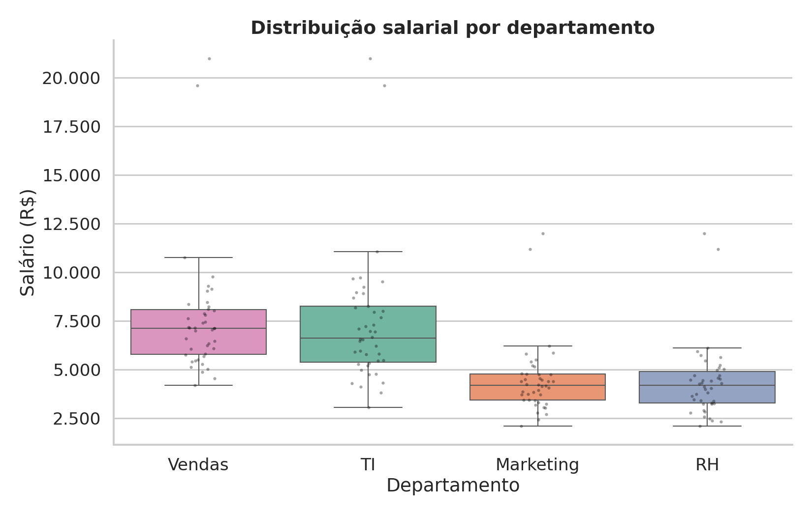
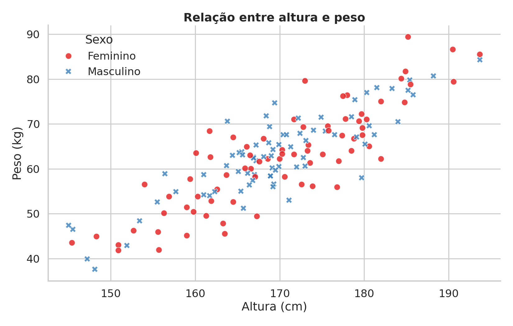
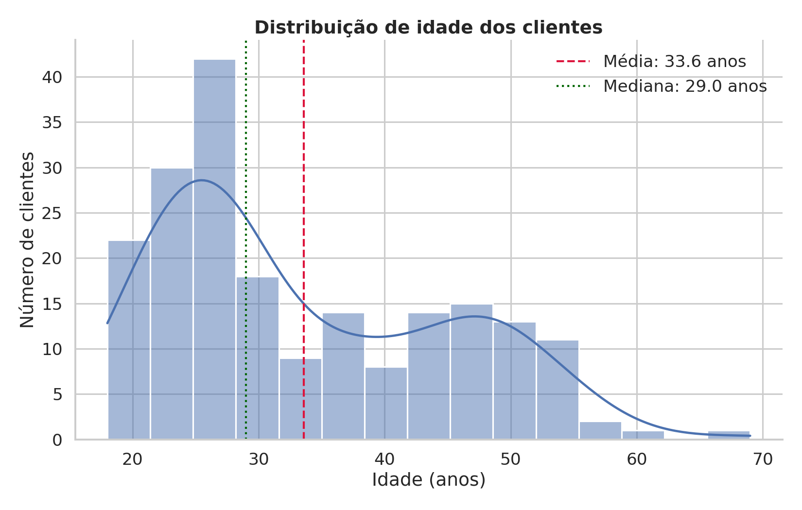
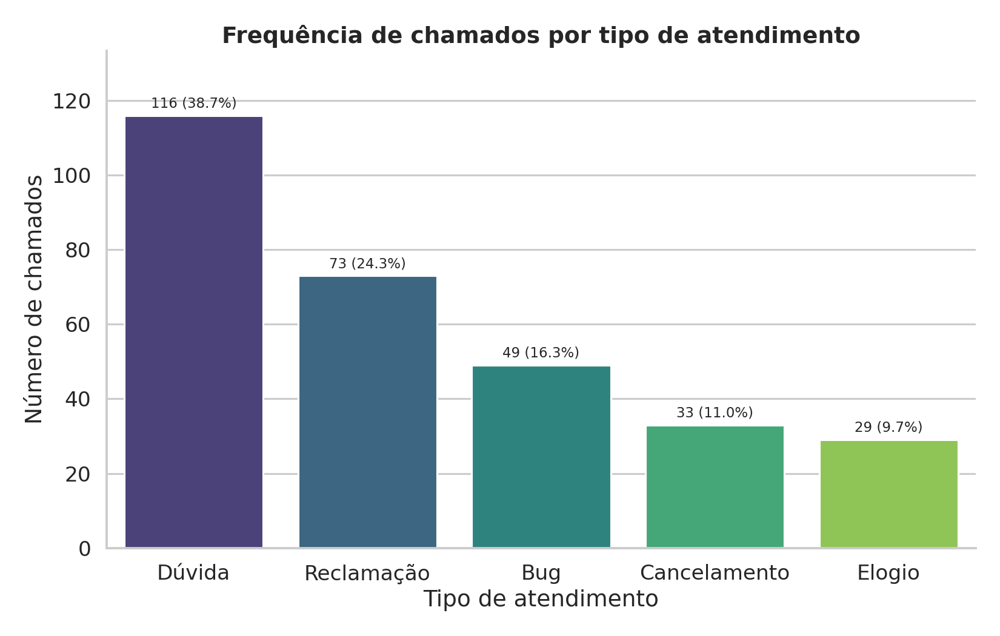
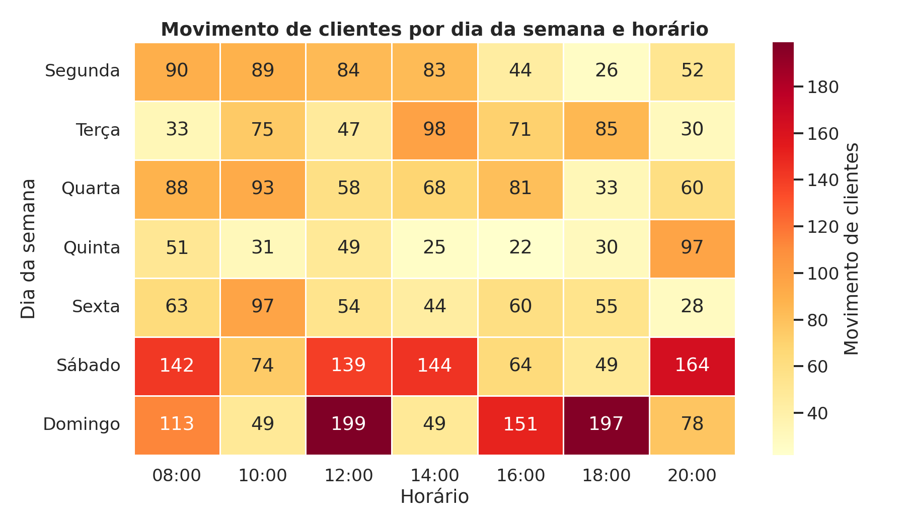
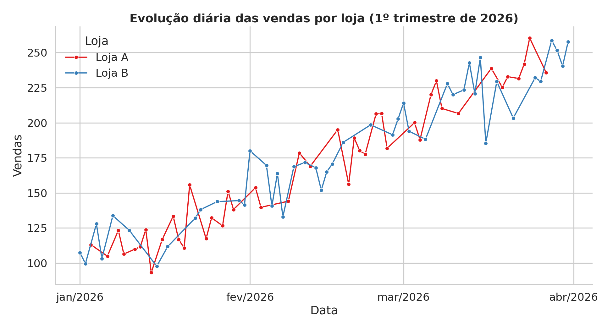
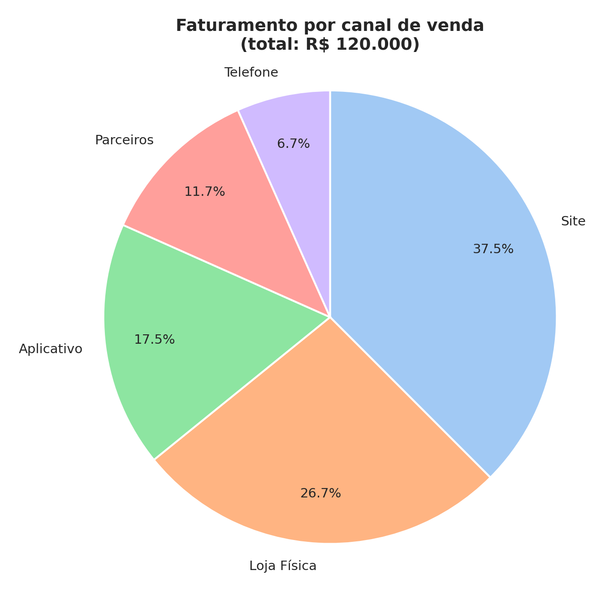
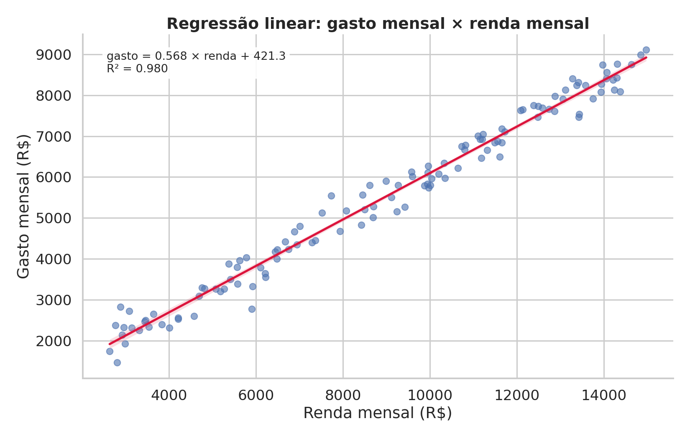

# Visualização de Dados com Python

Nove gráficos gerados a partir de nove arquivos CSV, com **um script independente por gráfico**,
usando `pandas`, `matplotlib`, `seaborn` e `scipy`.

## Estrutura

```
├── dados/       # arquivos CSV de entrada
├── scripts/     # um script por gráfico (+ gerar_todos.py)
├── graficos/    # imagens PNG geradas
└── requirements.txt
```

## Gráficos

| Dados | Script | Gráfico | Saída |
|---|---|---|---|
| `dados_barras.csv` | `grafico_barras.py` | Barras agrupadas: vendas médias por categoria e região | `graficos/barras.png` |
| `dados_boxplot.csv` | `grafico_boxplot.py` | Boxplot: salário por departamento | `graficos/boxplot.png` |
| `dados_dispersao.csv` | `grafico_dispersao.py` | Dispersão: altura × peso, por sexo | `graficos/dispersao.png` |
| `dados_distribuicao.csv` | `grafico_distribuicao.py` | Histograma + densidade: idade dos clientes | `graficos/distribuicao.png` |
| `dados_frequencia.csv` | `grafico_frequencia.py` | Frequência de chamados por tipo de atendimento | `graficos/frequencia.png` |
| `dados_heatmap.csv` | `grafico_heatmap.py` | Mapa de calor: movimento por dia e horário | `graficos/heatmap.png` |
| `dados_linhas.csv` | `grafico_linhas.py` | Linhas: vendas diárias por loja | `graficos/linhas.png` |
| `dados_pizza.csv` | `grafico_pizza.py` | Pizza: faturamento por canal de venda | `graficos/pizza.png` |
| `dados_regressao.csv` | `grafico_regressao.py` | Regressão linear: gasto × renda | `graficos/regressao.png` |

## Como executar

```bash
python -m venv .venv
source .venv/bin/activate        # Windows: .venv\Scripts\activate
pip install -r requirements.txt

# um gráfico específico
python scripts/grafico_pizza.py

# todos de uma vez
python scripts/gerar_todos.py
```

Os scripts usam caminhos relativos à raiz do projeto, então podem ser executados de qualquer pasta.

## Prévia










